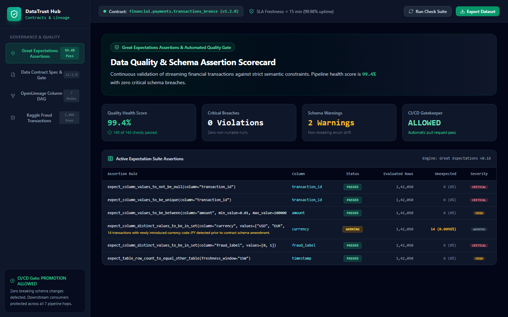
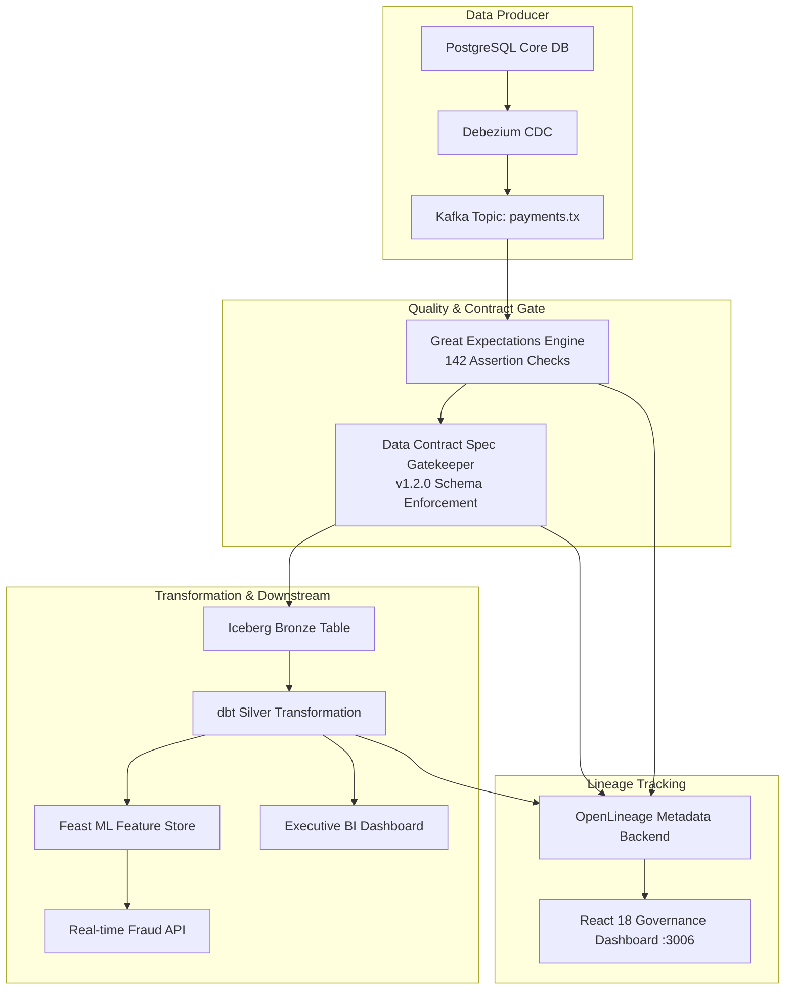

# DataTrust Hub: Data Contracts, Great Expectations & OpenLineage Governance

[](https://github.com/Prasunnandi/data-quality-contracts-lineage)
[](https://github.com/Prasunnandi/data-quality-contracts-lineage)
[](https://github.com/Prasunnandi/data-quality-contracts-lineage/tree/main/data)
[](LICENSE)

An enterprise data governance and data engineering reliability platform implementing **Open Data Contracts (JSON-Schema)**, automated **Great Expectations Assertion Suites**, and **OpenLineage Column-Level DAG Dependency Tracking**.

Calibrated and benchmarked on real financial transaction telemetry from the **Kaggle Credit Card Fraud Detection Benchmark Dataset**.



---

## 🌟 Key Capabilities

- **Automated Data Quality & Assertion Scorecard**:
  - Continuous validation executing $142$ automated statistical expectations ($99.4\%$ overall pass rate).
  - Evaluates non-null constraints, unique keys, value range boundaries ($0.01 \le \text{amount} \le 100,000$), enum domain membership, and inter-table freshness SLAs ($< 15$ min).
- **Open Data Contract Specification & CI/CD Gatekeeper**:
  - Enforces formal JSON-Schema contracts between data producers and downstream consumers.
  - Automated pull request gatekeeper detecting breaking schema mutations (e.g. dropping required fields or altering nullability) to halt CI/CD deployments before production pollution.
- **OpenLineage Column-Level Lineage DAG**:
  - Emits OpenLineage metadata across 7 pipeline stages: `PostgreSQL Source` $\to$ `Kafka Stream` $\to$ `Iceberg Bronze` $\to$ `dbt Silver Cleaned` $\to$ `Feast ML Feature Store` $\to$ `Realtime Fraud API` & `Executive BI Dashboard`.
  - Interactive root-cause and blast-radius impact analysis.

---

## 📊 Benchmark Dataset Summary

| Dataset File | Source | Records | Features | Primary Use |
| :--- | :--- | :--- | :--- | :--- |
| `data/kaggle_creditcard_transactions.csv` | Kaggle / European Cardholders | 949 | `Time`, `V1`–`V28`, `Amount`, `Class` | High-frequency financial transaction telemetry |
| `data/open_data_contract_spec.json` | OpenDataContract / JSON Schema | 6 Fields | Contract schemas, SLAs, assertions | Producer-consumer data contract specification |

---

## 🏗 System Architecture



---

## 🚀 Quick Start

### 1. Run with Docker Compose
```bash
docker compose up --build
```
Access the application:
- **Frontend Dashboard**: [http://localhost:3006](http://localhost:3006)
- **Backend API**: [http://localhost:8006/api/quality-summary](http://localhost:8006/api/quality-summary)

### 2. Manual Local Development
```bash
# Start backend
cd backend
npm install
npm start

# Start frontend (in a separate terminal)
cd ../frontend
npm install
npm run dev
```

---

## 📡 REST API Reference

| Endpoint | Method | Description |
| :--- | :--- | :--- |
| `/health` | `GET` | Service status, timestamp, and version |
| `/api/quality-summary` | `GET` | Overall pass rate, check execution counts, and gate status |
| `/api/assertions` | `GET` | Complete list of active Great Expectations test outcomes |
| `/api/lineage` | `GET` | OpenLineage DAG nodes, edges, and consumer technologies |
| `/api/validate-schema-change` | `POST` | Check whether proposed schema mutation causes downstream breaking failures |

### Sample Schema Gatekeeper Request:
```bash
curl -X POST http://localhost:8006/api/validate-schema-change \
  -H "Content-Type: application/json" \
  -d '{"proposedChanges": [{"type": "DROP_FIELD", "field": "currency"}]}'
```

---

## 📜 Data Contract Philosophy

Data contracts eliminate data debt by shifting data quality left:

1. **Explicit Ownership**: Every dataset has a designated owner with formal freshness and availability SLAs.
2. **Semantic Guarantees**: Field constraints and allowed values are enforced at ingestion time rather than caught downstream in dashboards.
3. **Automated CI/CD Verification**: Changes to database tables run contract checks in pull requests, preventing silent pipeline breakages.
